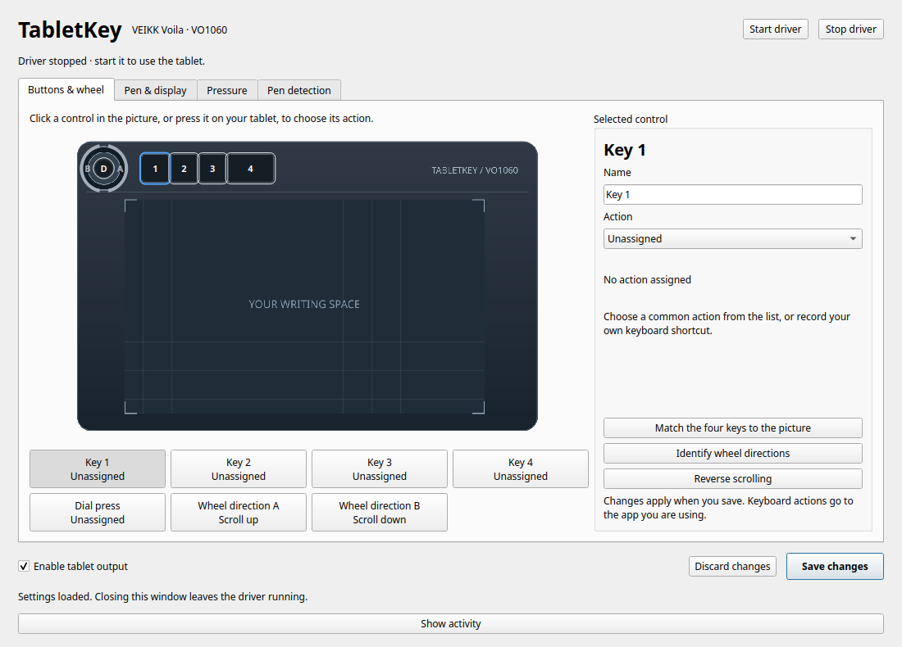
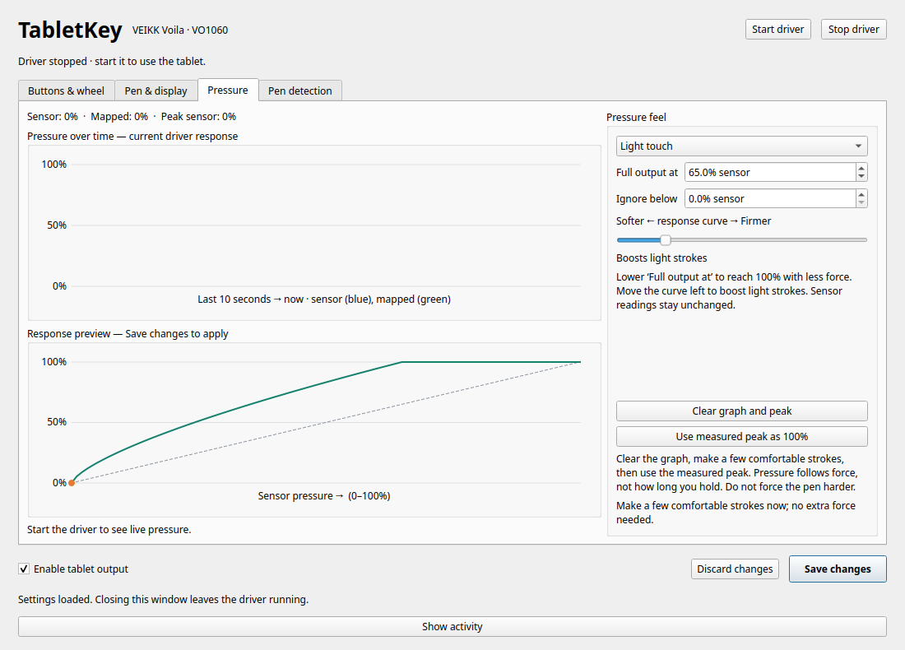

<h1 align="center">TabletKey</h1>

  
  

  A standalone Linux driver and settings app for the <strong>VEIKK Voila VO1060</strong> (USB <code>2feb:000b</code>). 
  Welcome—make the keys, wheel, writing area, and pen pressure your own. No OpenTabletDriver required.

<strong>Open your tablet's settings</strong>

<code>uvx tabletkey</code>

  Connect your tablet, click <strong>Start driver</strong>, and make it yours. 
  <a href="https://tabletkey.hyperoot.dev/getting-started/">First-time setup</a> · VEIKK VO1060 · COSMIC / Wayland

## Credits and License

Independent of VEIKK. Protocol research references [OpenTabletDriver](https://github.com/OpenTabletDriver/OpenTabletDriver).
Code, documentation, and original tablet artwork: [MIT](https://github.com/HYP3R00T/TabletKey/blob/main/LICENSE).

Made with ❤️ by <a href="https://github.com/HYP3R00T">HyperRoot</a>

