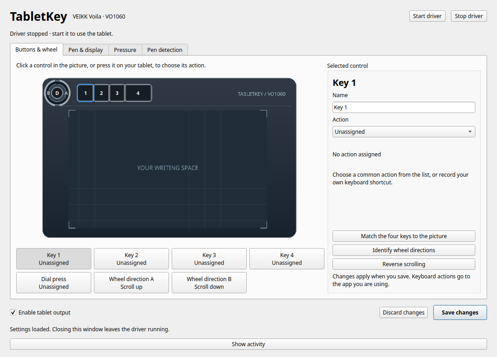
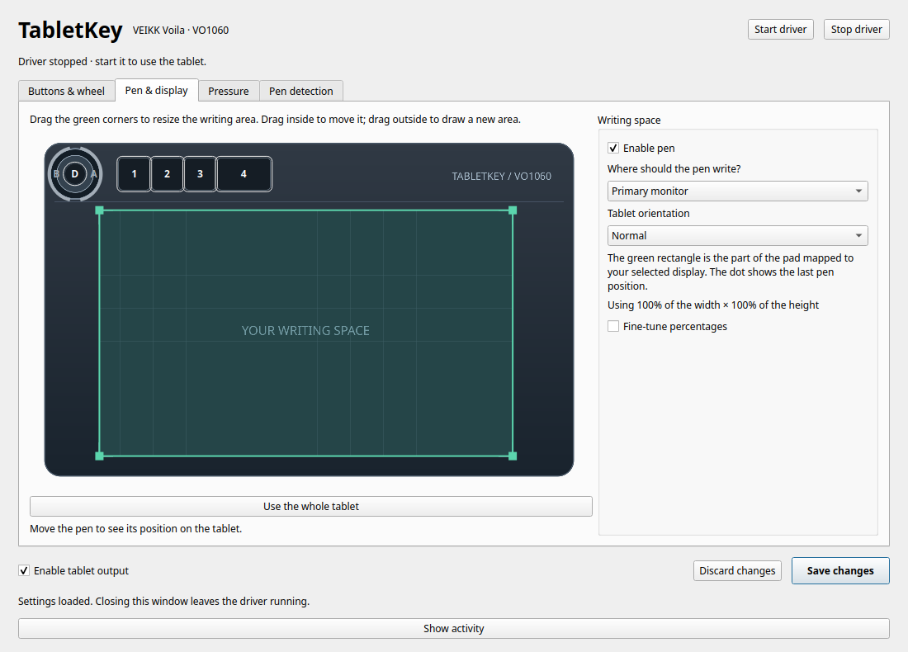
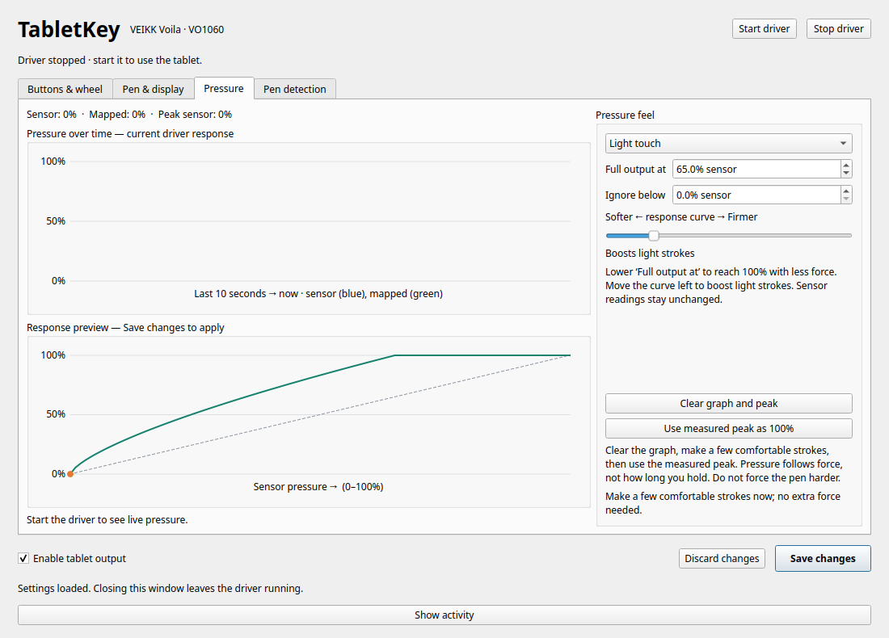
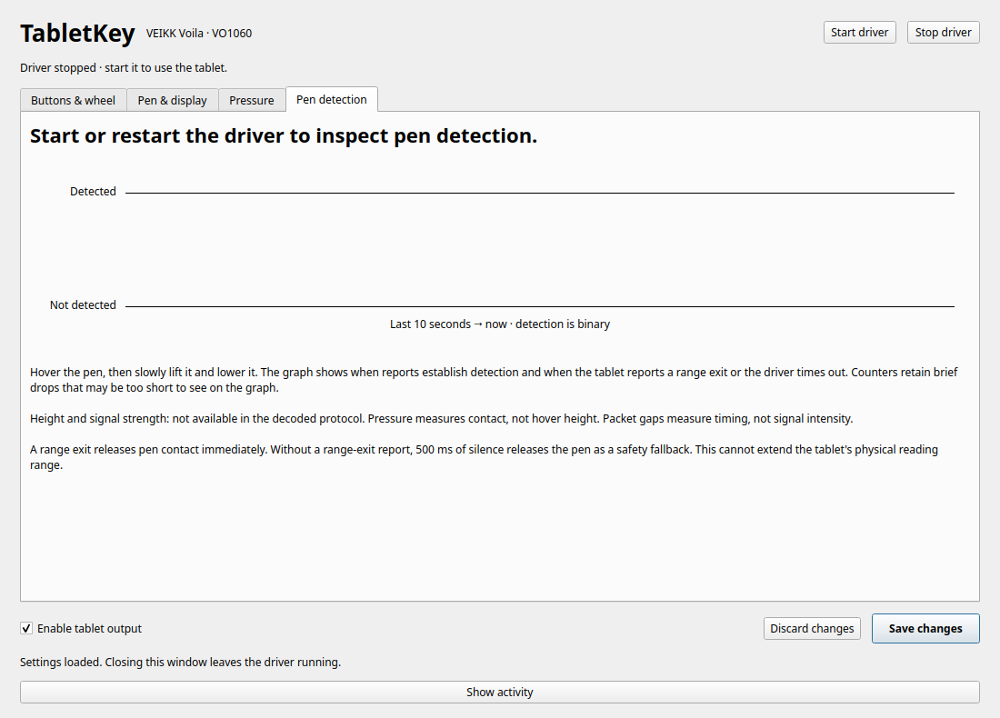

# Make it yours

Use the settings window for everyday changes. **Save changes** applies a complete profile;
**Discard changes** reloads the saved one. Closing the window leaves the background driver running.

## Buttons and wheel



Click a control on the original tablet diagram, select one below it, or press the physical button.
A blue outline marks the selection; green highlights show live activity. The four numbered keys
run from nearest the dial outward. The dial's centre press is labelled **D**.

Choose a preset for editing, browser navigation, scrolling, media, or volume. For anything else,
choose **Custom shortcut**, click **Record a shortcut**, type the chord, and click outside the recorder.
The shortcut uses Linux key codes; keyboard layout and the receiving app determine its effect.
Rename a control to something useful such as “Undo stroke”.

- **Match the four keys to the picture** learns physical order without reassigning bindings.
- **Identify wheel directions** asks you to turn clockwise and learns both labels.
- **Reverse scrolling** swaps the two wheel actions.
- **Enable tablet output** pauses/resumes pen, shortcuts, and wheel together.

The current profile is global. Switching from Brave to Obsidian does not switch mappings.
For scripts, the CLI accepts hardware identifiers:

```sh
uvx tabletkey config set button_01 'CTRL+Z'
uvx tabletkey config output --disable
uvx tabletkey config output --enable
```

## Pen and display



Choose a monitor, all enabled monitors, and an orientation. Drag the active area's corners to resize,
drag inside to move it, or drag outside to draw a new rectangle. **Use the whole tablet** resets it.
**Fine-tune percentages** exposes exact bounds. The live position dot helps you see the mapping.

All-monitor mode spans the logical desktop, choosing the nearest output for gaps. It is implemented
but physical crossing still needs validation. Display changes rebuild output as needed.

```sh
uvx tabletkey displays
uvx tabletkey config display HDMI-A-1
uvx tabletkey config display all
```

`HDMI-A-1` is an example; use a connector listed on your machine.
COSMIC routing changes only entries whose names begin with `TabletKey VO1060 Pen /`.
Unrelated settings are preserved; a first-write backup is saved beside COSMIC's configuration.
Malformed or concurrently edited configuration is rejected rather than overwritten.

## Pressure



The time graph separates raw sensor pressure from actual mapped pressure over the last ten seconds.
The response graph previews how the current controls would map sensor input; unsaved edits affect
that preview only. The sensor's declared maximum is 8191, not a force measurement in newtons.

| Control | Effect |
|---|---|
| Linear | Original one-to-one sensor response |
| Light touch | Full output at 65% sensor input; boosts light strokes |
| Full output at | Choose the sensor level that produces 100% output |
| Response curve | Boost lighter strokes or require firmer strokes |
| Ignore below | Suppress low pressure noise; leave at zero unless needed |

For a personal response, clear the graph, make comfortable strokes, and choose
**Use measured peak as 100%**. Then save. Do not press harder just to reach the sensor's full range.
Pressure depends on force, not holding duration. Values above the declared range are rejected and
reported diagnostically; the app does not silently redefine the sensor maximum.

## Pen detection



Detection is binary. The tab shows hover/contact, recent detection transitions, last-report age,
reports in the last second, the largest processing gap during detection, and virtual-pen proximity.
Counters retain brief range exits that are too short to follow visually. Up to 128 transitions are retained;
very rapid flickering can shorten the displayed ten-second window.

An explicit tablet range exit releases contact and proximity immediately. In its absence,
500 ms without a valid pen report triggers a safety timeout. These are counted separately.
There is no added hover grace period. A cursor-shape change alone does not establish its cause.

No height or signal-intensity field is established. Pressure is not hover distance, and packet gaps
are timing diagnostics, not signal strength. Use an external ruler/reference to measure physical height.

## Files and privacy

| Location | Contents |
|---|---|
| `$XDG_CONFIG_HOME/tabletkey/settings.json` | Validated global bindings, pen area/display, and pressure response |
| `$XDG_CONFIG_HOME/tabletkey/interface.json` | Names, learned key order, and wheel orientation |
| `$XDG_RUNTIME_DIR/tabletkey/` | Private IPC socket, daemon lock, and rotating logs |
| COSMIC `input_devices.tabletkey.bak` | First-write routing backup beside the original file |
| `captures/` in a source checkout | Explicitly recorded local diagnostics; ignored by Git |

The config default is `~/.config`. If `XDG_RUNTIME_DIR` is absent, the app uses a private fallback
under `/tmp`. Pressure history and detection transitions are bounded in memory, not logged to disk.
A manual settings-file edit needs `daemon reload`; GUI saves apply through the running daemon.

## Stop, update, or uninstall

Stop the daemon before replacing its Python environment:

```sh
uvx tabletkey daemon stop
uv tool upgrade tabletkey
```

For an installed tool, use `tabletkey daemon stop` instead of the first line.
Start it again after upgrading. For uvx-only use, stop first, then use `uvx tabletkey@latest`.
To remove a persistent installation, stop it and run `uv tool uninstall tabletkey`.
Settings remain available for a future reinstall.

One-time device access is separate from the Python package. If removing TabletKey permanently,
review and remove its two setup files:

```sh
sudo rm /etc/udev/rules.d/70-tabletkey.rules /etc/modules-load.d/tabletkey.conf
sudo udevadm control --reload-rules
```

Existing session ACLs can persist until device reconnection or session restart. Do not unload uinput
if another app uses it. The app-owned COSMIC routing entries and backup are left in place;
uninstalling the Python tool does not restore desktop configuration automatically.
