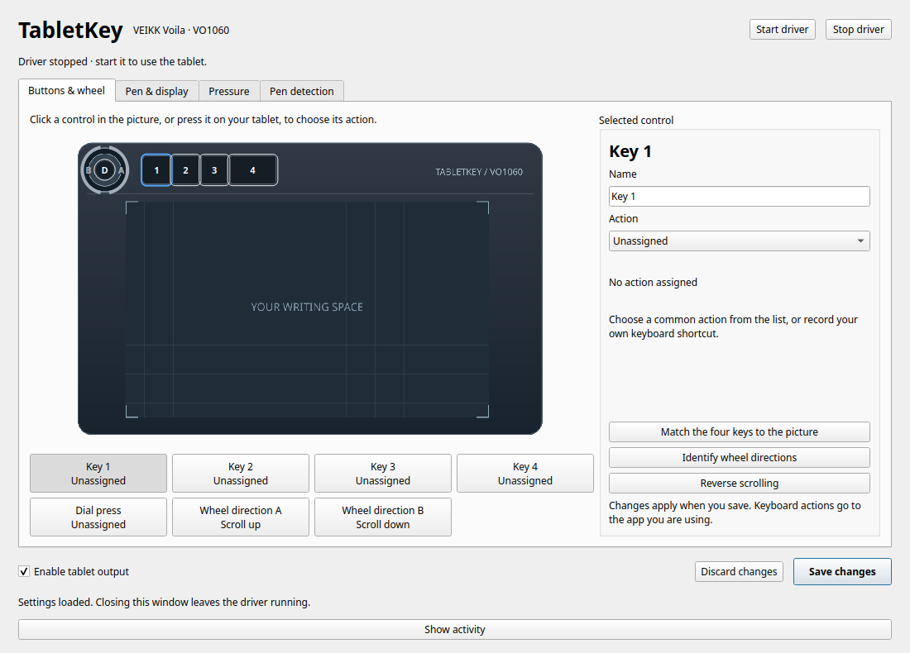

---
hide:
  - toc
---

<div class="tk-hero" markdown>

<div class="tk-eyebrow">VEIKK VO1060 · COSMIC · LINUX</div>

# Your tablet. Your shortcuts

Give your pen a comfortable touch, your wheel a purpose, and every button a job you remember.
TabletKey is a standalone Python driver with a visual settings app for the VEIKK VO1060 on
COSMIC Linux. No OpenTabletDriver installation required.

[Set up your tablet](getting-started.md){ .md-button .md-button--primary }
[Explore the controls](guide.md){ .md-button }

</div>



<div class="grid cards" markdown>

- **Press it. See it. Map it.**

    Controls light up as you use them. Choose an action or record your shortcut.
    No hexadecimal guessing games.

- **Write with a lighter hand.**

    Try Light touch, inspect the response curve, and calibrate to a comfortable stroke.
    Raw and mapped pressure stay separate.

- **Keep your space.**

    Choose a display and drag the tablet's active area. Closing settings keeps the
    background driver—and your mappings—running.

- **Understand the signal.**

    See when the pen is hovering, touching the tablet, or moving out of range
    with a live detection timeline.

</div>

## A small command, a useful window

```sh
uvx tabletkey setup --install  # explicit one-time Linux device permissions
uvx tabletkey                  # open settings, then click Start driver
```

Connect your tablet, click **Start driver**, and choose your settings.
For daily use, `uv tool install tabletkey` provides a persistent installation.
Prefer the code? [Run from source](getting-started.md#from-source).

## Compatibility

TabletKey targets **VEIKK Voila VO1060, USB `2feb:000b`, on COSMIC Wayland**.
It supports pen input, pressure adjustment, global button shortcuts, wheel scrolling, and monitor mapping.
Per-app profiles, tilt output, and other tablet models are not supported.
See [desktop compatibility](getting-started.md#desktop-compatibility) for the current Linux integration.

[What's verified](hardware.md){ .md-button }
[Get help](troubleshooting.md){ .md-button }

Independent project. Not affiliated with VEIKK. Original diagram and project code are MIT licensed.
